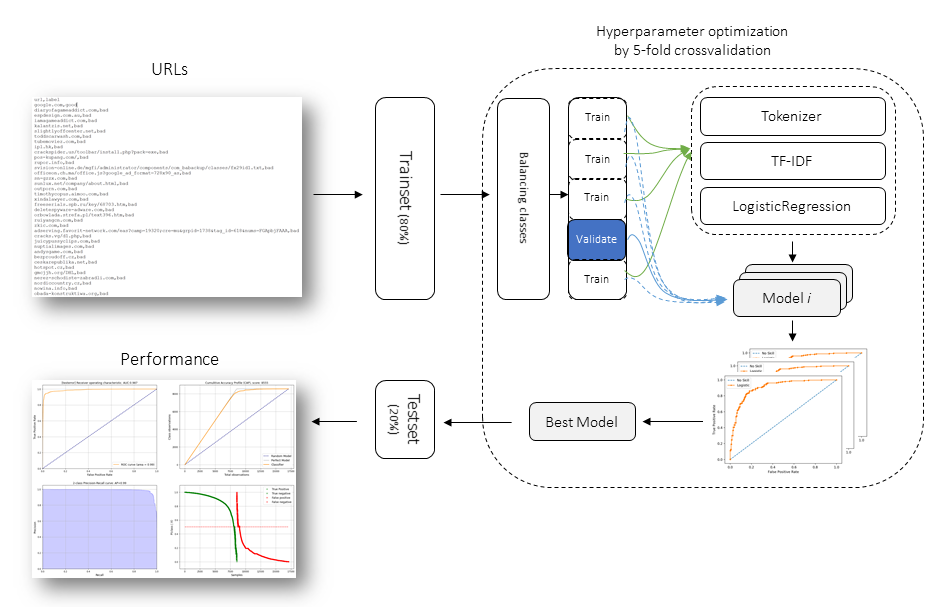

Background
#############

Local coding models are often sold on two claims: strong code quality and long
context. Short-prompt leaderboards do not test both at once. **localbenchmark** is built
to measure them together under realistic local constraints.

Aim
*****

Provide a single, resume-safe evaluation pipeline that:

* Runs **HumanEval-style** coding tasks through **LM Studio**
* Stresses **context windows** (e.g. 50k–180k tokens), with optional fill
* Records **pass rate**, **decode speed**, **TTFT**, and **peak GPU memory**
* Aborts configurations that are too slow to finish in practice
* Produces **rank-sum plots** so quality and speed are not confused

Results
********

Each **model × context** run is stored in durable CSV files. A summary file
tracks finished configurations so restarts skip completed work. Ranking plots
combine pass rate, speed, latency, memory, and context capability — with higher
weight on pass rate and decode speed.

Schematic overview
####################

The evaluation flow is:

1. Discover each model's max context from LM Studio
2. Load the model at the requested window size
3. Optionally fill part of the context with unrelated code
4. Run coding problems; execute generated code against tests
5. Log metrics; abort if decode speed stays below a minimum
6. Aggregate results and generate ranking / trend plots

.. _schematic_overview:

   High-level flow: LM Studio → load model → HumanEval / speed probe → CSV → plots.

.. include:: add_bottom.add
