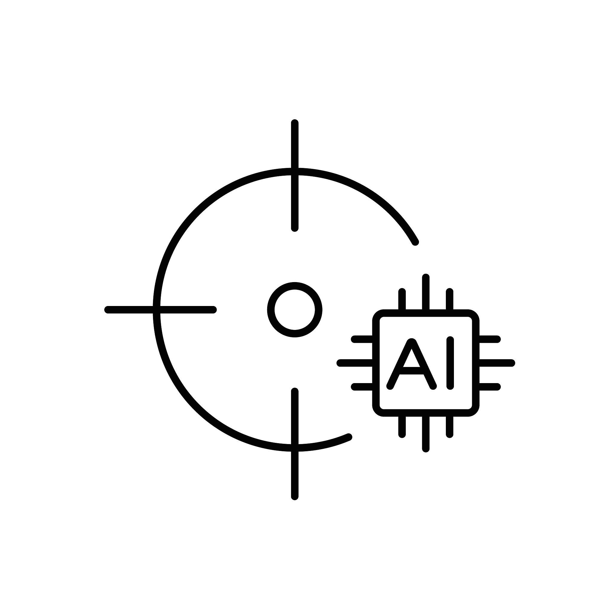

localbenchmark
===================================

|python| |pypi| |docs| |stars| |LOC| |downloads_month| |downloads_total| |license| |forks| |open issues| |project status| |medium| |colab| |DOI| |repo-size| |donate|

-----------------------------------

.. container:: logo-description

   .. image:: ../figs/logo.png
      :width: 125px
      :height: 125px
      :align: left
      :alt: localbenchmark logo

   *localbenchmark* is a Python package for **local LLM evaluation**: coding benchmarks,
   long-context stress tests, speed probes, and ranking plots — driven through
   `LM Studio <https://lmstudio.ai/>`_ or any other OpenAI-compatible server (llama.cpp, vLLM, Ollama, ...).

   It answers a practical question: *can this model still write correct code when
   the context window is large, and is it fast enough that you would actually use it?*

   .. raw:: html

      

-----------------------------------

**Key Features:**

    - **Dry run**: Estimate memory, quantization and decode speed before loading a model
    - **Coding benchmarks**: HumanEval, MBPP and SWE-bench via LM Studio or any OpenAI-compatible server (temperature 0)
    - **Knowledge suites**: Closed-book questions, scored deterministically, with an optional judge model for open-ended answers
    - **Company QA**: Questions answered from your own documents, with unanswerable questions that must be declined
    - **Long context**: Fixed windows (e.g. 50k–180k) to test how speed and memory change
    - **Resume-safe CSVs**: Skip finished configurations; retry LLM errors
    - **Rank-sum plots**: Pass rate, speed, TTFT, GPU, context — weighted ranking
    - **Any backend**: LM Studio's native API or any OpenAI-compatible server, detected automatically
    - **Model discovery**: ``--list`` shows every available model; without ``--models`` all of them are tested

-----------------------------------

Support
-----------

.. raw:: html

    

        <iframe
            srcdoc=''
            style="border:none; width:250px; height:80px; flex-shrink: 0;">
        </iframe>
        

            
<strong>Yes! This library is entirely free but it runs on coffee. </strong>Your ❤️ is important to keep maintaining this package. You can <a href="https://erdogant.github.io/localbenchmark/pages/html/Documentation.html">support</a> in various ways, have a look at the <a href="https://erdogant.github.io/localbenchmark/pages/html/Documentation.html">sponsor page</a>.

        

    

-----------------------------------

.. tip::
	`One Benchmark That Tests It All. <https://erdogant.medium.com>`_

Installation
-------------

.. code-block:: console

    pip install localbenchmark

-----------------------------------

Content
=======

.. toctree::
   :maxdepth: 1
   :caption: Background

   Abstract
   Quickstart
   Installation

.. toctree::
   :maxdepth: 2
   :caption: Benchmarks

   Dry_Run
   Coding
   Knowledge_Suites
   Plots
   Save_and_Load

.. toctree::
   :maxdepth: 1
   :caption: Documentation

   Documentation
   localbenchmark.localbenchmark

Indices and tables
==================

* :ref:`genindex`
* :ref:`modindex`
* :ref:`search`

.. |python| image:: https://img.shields.io/pypi/pyversions/localbenchmark.svg
    :alt: |Python
    :target: https://erdogant.github.io/localbenchmark/

.. |pypi| image:: https://img.shields.io/pypi/v/localbenchmark.svg
    :alt: |Python Version
    :target: https://pypi.org/project/localbenchmark/

.. |docs| image:: https://img.shields.io/badge/Sphinx-Docs-blue.svg
    :alt: Sphinx documentation
    :target: https://erdogant.github.io/localbenchmark/

.. |stars| image:: https://img.shields.io/github/stars/erdogant/localbenchmark
    :alt: Stars
    :target: https://img.shields.io/github/stars/erdogant/localbenchmark

.. |LOC| image:: https://sloc.xyz/github/erdogant/localbenchmark/?category=code
    :alt: lines of code
    :target: https://github.com/erdogant/localbenchmark

.. |downloads_month| image:: https://static.pepy.tech/personalized-badge/localbenchmark?period=month&units=international_system&left_color=grey&right_color=brightgreen&left_text=PyPI%20downloads/month
    :alt: Downloads per month
    :target: https://pepy.tech/project/localbenchmark

.. |downloads_total| image:: https://static.pepy.tech/personalized-badge/localbenchmark?period=total&units=international_system&left_color=grey&right_color=brightgreen&left_text=Downloads
    :alt: Downloads in total
    :target: https://pepy.tech/project/localbenchmark

.. |license| image:: https://img.shields.io/badge/license-MIT-green.svg
    :alt: License
    :target: https://github.com/erdogant/localbenchmark/blob/master/LICENSE

.. |forks| image:: https://img.shields.io/github/forks/erdogant/localbenchmark.svg
    :alt: Github Forks
    :target: https://github.com/erdogant/localbenchmark/network

.. |open issues| image:: https://img.shields.io/github/issues/erdogant/localbenchmark.svg
    :alt: Open Issues
    :target: https://github.com/erdogant/localbenchmark/issues

.. |project status| image:: http://www.repostatus.org/badges/latest/active.svg
    :alt: Project Status
    :target: http://www.repostatus.org/#active

.. |medium| image:: https://img.shields.io/badge/Medium-Blog-green.svg
    :alt: Medium Blog
    :target: https://erdogant.github.io/localbenchmark/pages/html/Documentation.html#medium-blog

.. |donate| image:: https://img.shields.io/badge/Support%20this%20project-grey.svg?logo=github%20sponsors
    :alt: donate
    :target: https://erdogant.github.io/localbenchmark/pages/html/Documentation.html#

.. |colab| image:: https://colab.research.google.com/assets/colab-badge.svg
    :alt: Colab example
    :target: https://erdogant.github.io/localbenchmark/pages/html/Documentation.html#colab-notebook

.. |DOI| image:: https://zenodo.org/badge/231843440.svg
    :alt: DOI
    :target: https://zenodo.org/badge/latestdoi/231843440

.. |repo-size| image:: https://img.shields.io/github/repo-size/erdogant/localbenchmark
    :alt: repo-size
    :target: https://github.com/erdogant/localbenchmark

.. include:: add_bottom.add
